<div align="center">

# 🍌 Open-Vision-Banana

**An open, community reproduction of Vision Banana — *Image Generators are Generalist Vision Learners***

*Instruction-tune an open image generator so that depth, surface normals and segmentation all come out as RGB images — with open weights, public data and an auditable evaluation.*

[](https://arxiv.org/abs/2604.20329)
[](#citation)
[](https://huggingface.co/khazic?search=ovb-)
[](LICENSE)
[](https://www.python.org/downloads/)
[](https://github.com/isLinXu/open-vision-banana/actions/workflows/ci.yml)
[](tests/)

[](https://github.com/isLinXu/open-vision-banana/stargazers)
[](#-contributing)
[](#where-we-need-help)

[News](#-news) · [Results](#-results) · [Quick Start](#-quick-start) · [Training](#training) · [Contributing](#-contributing) · [Datasets](docs/DATASETS.md) · [Paper alignment](#paper-alignment-statement)

<br>

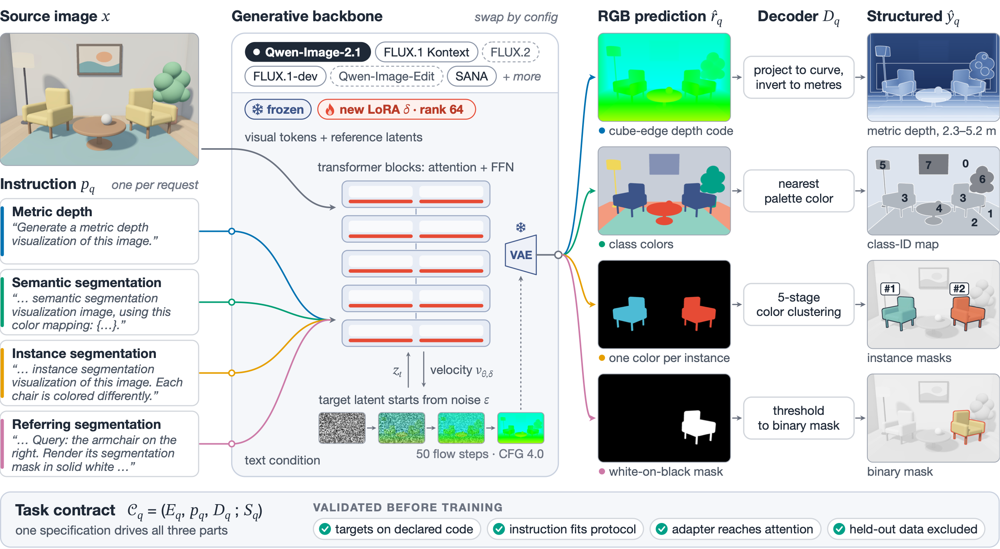

<sub><b>Overview.</b> A frozen image generator with one shared LoRA adapter answers every task with an RGB image; a fixed, parameter-free decoder turns that image back into metric depth, a class-ID map, instance masks or a binary referring mask. Each task is fully specified by its contract (encoder, instruction, decoder).</sub>

</div>

> [!IMPORTANT]
> This is an **unofficial, community reproduction**. It is not affiliated with or endorsed by the paper's authors. Vision Banana is built on the closed Nano Banana Pro model and in-house data; **this repository has not reproduced the paper's numbers**. Our measured scores are in [Results](#-results), next to the paper's for reference.

---

## Table of Contents

- [News](#-news) · [Why Open-Vision-Banana](#-why-open-vision-banana) · [Key findings](#-key-findings) · [Gallery](#-gallery) · [How It Works](#how-it-works) · [Results](#-results)
- [Quick Start](#-quick-start) · [Models](#models) · [Training](#training) · [Supported Tasks](#supported-tasks) · [Key Algorithms](#key-algorithms)
- [Checkpoints](#checkpoints) · [Paper Alignment](#paper-alignment-statement) · [Benchmarks (from paper)](#benchmarks-from-paper) · [Evaluation & Export](#evaluation--export)
- [Docker](#docker) · [Project Structure](#project-structure) · [Contributing](#-contributing) · [Roadmap](#roadmap) · [Citation](#citation) · [License](#license)

---

## 📰 News

- **[2026-11-15]** 📌 Open release: the five key findings so far are summarized in [Key findings](#-key-findings).
- **[2026-11-15]** 🧪 Six exact LoRA merges of the I108 B arm, externally evaluated on all six benchmarks. None passes every gate; B `checkpoint-17500_best` stays the balanced pick ([#127](https://github.com/isLinXu/open-vision-banana/issues/127), [results](docs/evaluation/i127-merge-20261115/results.md)).
- **[2026-11-14]** 🔥 Prepared for the public release: cleaned code and docs, new overview and task-contract figures, and the I108 Fusion r64 results from an external evaluation ([#122](https://github.com/isLinXu/open-vision-banana/pull/122), [#128](https://github.com/isLinXu/open-vision-banana/pull/128)).
- **[2026-11-12]** 🎨 Interactive showcase in [`demo/`](demo/): normal-map relighting, depth point clouds and segmentation comparisons ([#121](https://github.com/isLinXu/open-vision-banana/pull/121)).
- **[2026-11-11]** 🎲 Depth seed ensembles in evaluation (`--depth-seed-ensemble K`, [#117](https://github.com/isLinXu/open-vision-banana/pull/117)) and experimental post-training objectives, on-policy distillation and GRPO ([#114](https://github.com/isLinXu/open-vision-banana/pull/114)).
- **[2026-11-10]** 📏 Optional metric-depth scale loss for the absolute-scale gap ([#113](https://github.com/isLinXu/open-vision-banana/pull/113), [docs](docs/metric_depth_scale_ablation.md)).
- **[2026-11-08]** 🚀 Fusion r64 large-scale plan: two 100k-step rsLoRA r64 arms on a fused Qwen-Image-2.1 base ([#109](https://github.com/isLinXu/open-vision-banana/pull/109), [docs](docs/fusion_r64_large_scale_plan.md)).
- **[2026-11-05]** 🏠 Observed indoor-depth supplement from ARKitScenes, DIODE and SUN RGB-D ([#104](https://github.com/isLinXu/open-vision-banana/pull/104)); versioned referring query prompts `query_v2` ([#103](https://github.com/isLinXu/open-vision-banana/pull/103)).

<details>
<summary><b>Earlier</b></summary>

- **[2026-11-03]** COCONut-B semantic and instance supervision ([#100](https://github.com/isLinXu/open-vision-banana/pull/100), [docs](docs/coconut_segmentation.md)).
- **[2026-11-02]** Full fine-tuning mode ([#94](https://github.com/isLinXu/open-vision-banana/pull/94)) and LingBot full-pool depth experiments ([#98](https://github.com/isLinXu/open-vision-banana/pull/98)).
- **[2026-10-28]** Static project page in [`website/`](website/) ([#85](https://github.com/isLinXu/open-vision-banana/pull/85)).
- **[2026-10-23]** Line-by-line paper-alignment audit, 58 checkable statements ([#46](https://github.com/isLinXu/open-vision-banana/pull/46), [docs](docs/PAPER_ALIGNMENT_AUDIT_2026-10-22.md)).
- **[2026-09-10]** v0.5.0, the pre-open-source release ([CHANGELOG](CHANGELOG.md)).

</details>

---

## ✨ Why Open-Vision-Banana

Vision Banana shows that instruction-tuning an image generator on a small amount of vision data, with every output written as an RGB image, gives one model that does segmentation, depth and normals. Its base model and data are closed. This repository rebuilds the recipe in the open so that anyone can train it, measure it and improve it.

- 🧩 **One interface for every task.** Each task is a *contract*: an RGB encoder, an instruction and a deterministic decoder. Depth, normals, semantic, instance and referring segmentation share one generator and one adapter.
- 🔓 **Open end to end.** Open backbones (Qwen-Image-2.1, SANA-1600M, FLUX.1-dev), public data with download → prepare → audit scripts, and published LoRAs on the Hugging Face Hub.
- 🔬 **Honest, auditable evaluation.** Paper protocols on official splits at native resolution, a zero-shot leakage audit, raw metrics as the headline with aligned metrics marked as diagnostics, and a 58-item audit against the paper text.
- ⚡ **Parameter-efficient.** rsLoRA r32 / r64 trains about 1.2 % / 2.4 % of the 7B Qwen-Image-2.1 transformer. One trainer drives 40+ registered model configurations.
- 🧪 **Built for research.** 2,000+ tests, seed-ensemble and depth-scale diagnostics, sharded evaluation and per-task validation losses.

---

## 🔎 Key findings

What the open recipe (frozen Qwen-Image-2.1, one shared rsLoRA, **metric** depth, public data) shows so far. Every number is from the tables in [Results](#-results).

1. **Geometry is learned early; absolute scale is not.** Across the 40 evaluated checkpoints of the two 100k-step runs, per-image median-aligned NYU δ1 stays at 0.89–0.93, while raw metric δ1 moves between 0.11 and 0.50. Almost all of the depth gap is one number per image.
2. **A single sample does not commit to a scale.** On run C1, a ten-seed log-scale median raises raw NYU δ1 from 0.348 to 0.516 with no retraining (`--depth-seed-ensemble`). It is a diagnostic at ten times the inference cost, not a method.
3. **Depth and 2D segmentation trade off under one adapter.** In arm B, NYU δ1 rises from 0.111 to 0.485 while Cityscapes mIoU falls from 0.362 to 0.293; ReasonSeg peaks at 0.440 at 20k and ends at 0.333. No checkpoint beats the fused base on every benchmark.
4. **Weight merging moves along the trade-off.** Six exact LoRA merges all improve ETH3D, and Cityscapes lands 0.7–1.8 points above the weighted average of the parents, but every merge loses 3–6 points of ReasonSeg against the balanced checkpoint.
5. **Validation flow loss does not select checkpoints.** Over the EMA checkpoints of each arm, lower loss goes with lower Cityscapes mIoU (Spearman ρ ≈ −0.9 between loss reduction and mIoU).

These are results on one backbone with one training seed per run. Checkpoints and merge recipes were inspected on the evaluation benchmarks, so the best scores are optimistic.

---

## 🎥 Gallery

Qwen-Image-2.1 from the I108 Fusion r64 runs on validation and test images of the evaluation benchmarks. Depth is shown as the RGB-coded image the model writes, before decoding to metres; instance colors are arbitrary per instance, so they need not match the ground-truth colors. The editing rows check that the adapter still follows ordinary editing instructions.

<table>
  <tr><th></th><th>Input</th><th>Prediction</th><th>Ground truth</th></tr>
  <tr><td><b>Metric depth</b><br><sub>NYU Depth V2 val</sub></td>
    <td>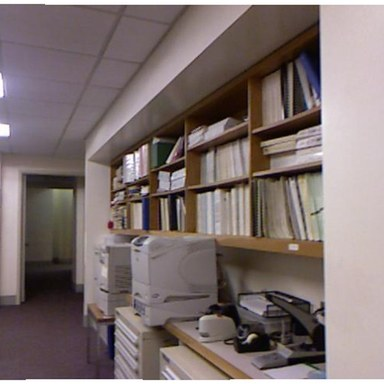</td>
    <td>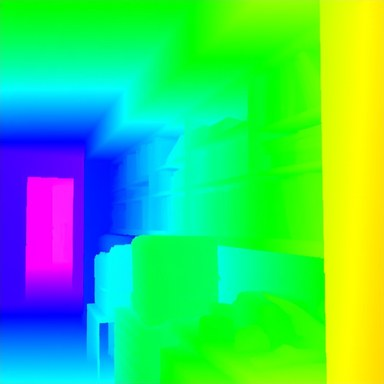</td>
    <td>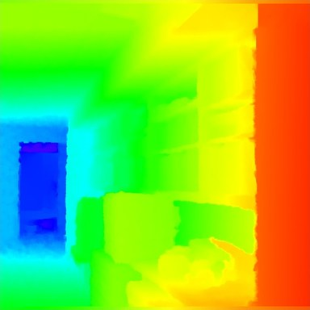</td></tr>
  <tr><td><b>Metric depth</b><br><sub>DIODE Indoor val</sub></td>
    <td>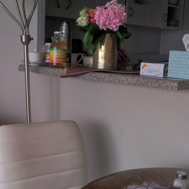</td>
    <td>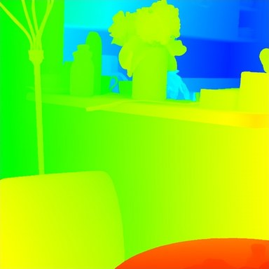</td>
    <td>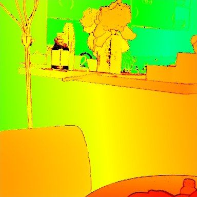</td></tr>
  <tr><td><b>Semantic</b><br><sub>Cityscapes val</sub></td>
    <td>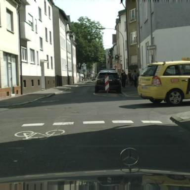</td>
    <td>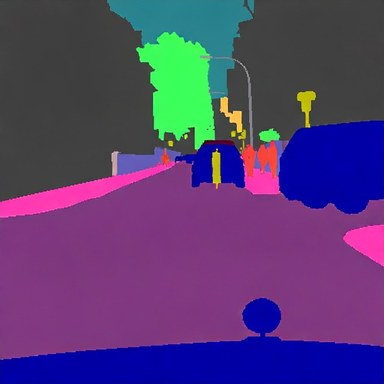</td>
    <td>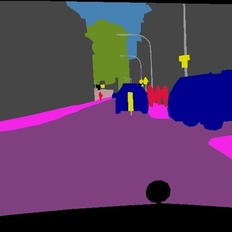</td></tr>
  <tr><td><b>Instance</b><br><sub>COCO val2017</sub></td>
    <td></td>
    <td>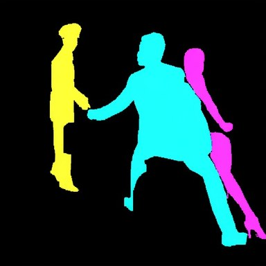</td>
    <td>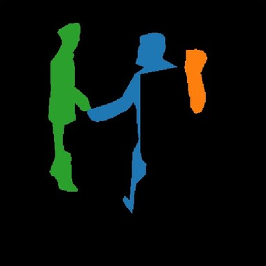</td></tr>
  <tr><td><b>Instance</b><br><sub>LVIS v1 val</sub></td>
    <td>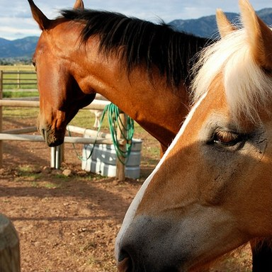</td>
    <td>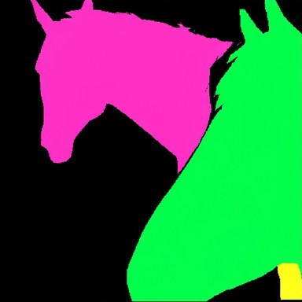</td>
    <td>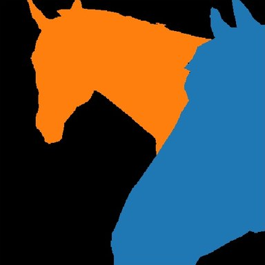</td></tr>
  <tr><td><b>Referring</b><br><sub>ReasonSeg val</sub></td>
    <td></td>
    <td>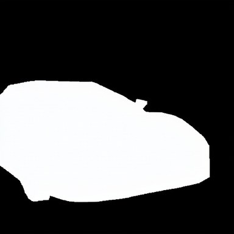</td>
    <td>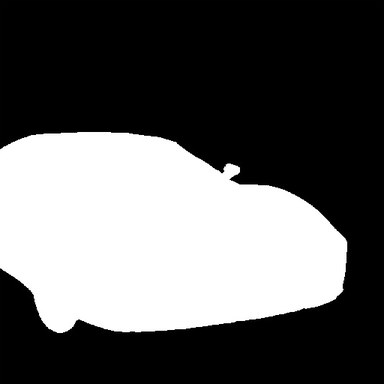</td></tr>
  <tr><td><b>Referring</b><br><sub>RefCOCOg val</sub></td>
    <td>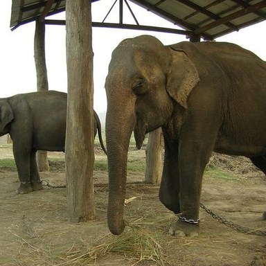</td>
    <td>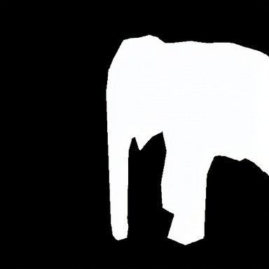</td>
    <td>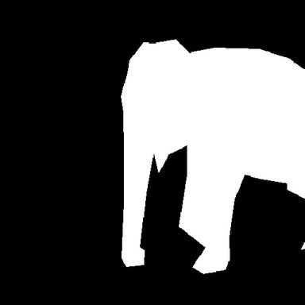</td></tr>
  <tr><th></th><th>Input</th><th>Prediction</th><th>Instruction</th></tr>
  <tr><td><b>Editing</b><br><sub>ImgEdit-Bench test</sub></td>
    <td></td>
    <td></td>
    <td><sub><i>“Add a small brown dog sitting inside the open trunk of the antique car.”</i></sub></td></tr>
  <tr><td><b>Editing</b><br><sub>COCO val2017</sub></td>
    <td></td>
    <td>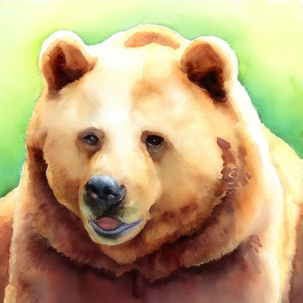</td>
    <td><sub><i>“Turn this photograph into a watercolor painting while preserving the composition and recognizable objects.”</i></sub></td></tr>
  <tr><td><b>Editing</b><br><sub>ImgEdit-Bench test</sub></td>
    <td></td>
    <td></td>
    <td><sub><i>“Transfer the image into a classic impasto oil-painting style.”</i></sub></td></tr>
</table>

<sub>Samples were picked for illustration and are not a random draw; benchmark-level numbers are in <a href="#-results">Results</a>.</sub>

<details>
<summary><b>Surface normals and earlier SANA-1600M samples</b></summary>

<br>

<table>
  <tr><th></th><th>Input</th><th>Prediction</th><th>Ground truth</th></tr>
  <tr><td><b>Depth</b></td>
    <td></td>
    <td></td>
    <td></td></tr>
  <tr><td><b>Depth</b></td>
    <td>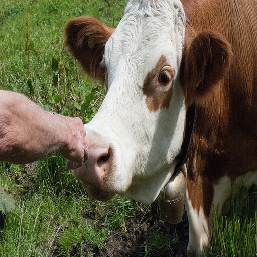</td>
    <td>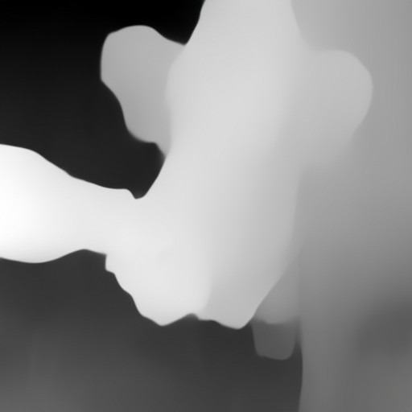</td>
    <td></td></tr>
  <tr><td><b>Normals</b></td>
    <td></td>
    <td>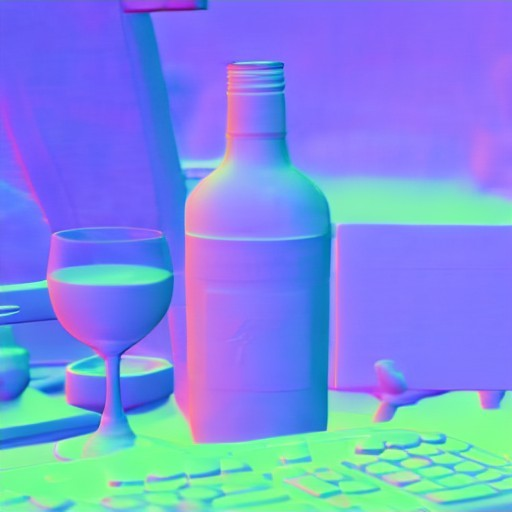</td>
    <td>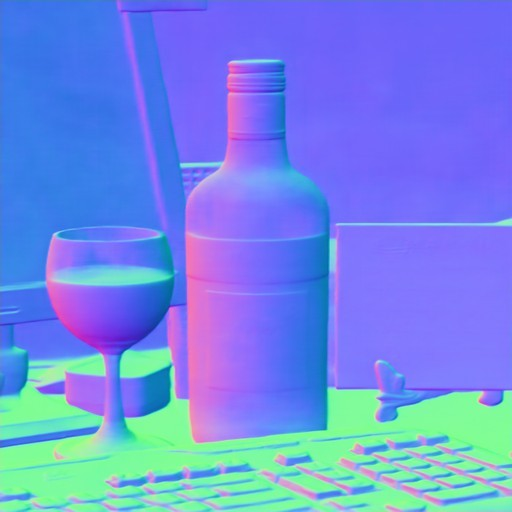</td></tr>
  <tr><td><b>Normals</b></td>
    <td>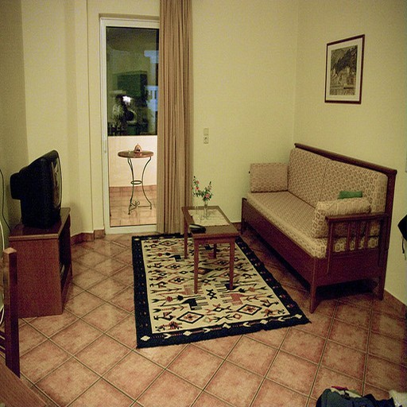</td>
    <td>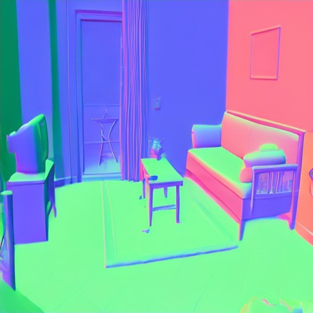</td>
    <td>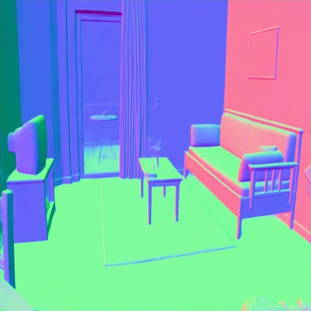</td></tr>
</table>

<sub>SANA-1600M, <a href="https://huggingface.co/khazic/ovb-fix_best3_rank64_60k"><code>khazic/ovb-fix_best3_rank64_60k</code></a> (EMA, step 60k), on held-out rows of its training manifest. These are same-source samples, not a zero-shot benchmark.</sub>

</details>

The interactive showcase with point clouds, normal relighting and segmentation comparisons is in [`demo/`](demo/): run `python -m http.server 8000 -d demo` and open `http://localhost:8000`.

---

## How It Works

<p align="center">
  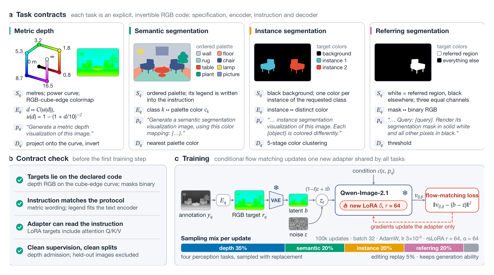
</p>

<sub><b>(a)</b> Each task is an explicit RGB code with a specification S<sub>q</sub>, encoder E<sub>q</sub>, instruction p<sub>q</sub> and decoder D<sub>q</sub>. <b>(b)</b> Contract checks run before the first training step. <b>(c)</b> Conditional flow matching updates one adapter shared by all tasks; the hyper-parameters and sampling mix shown are the Fusion r64 recipe in <a href="configs/experiments/fusion_r64_large_scale.yaml"><code>configs/experiments/fusion_r64_large_scale.yaml</code></a>. Editing replay is meant to preserve generation; retention has not been measured in this repository.</sub>

<details>
<summary><b>Data-flow diagram</b></summary>

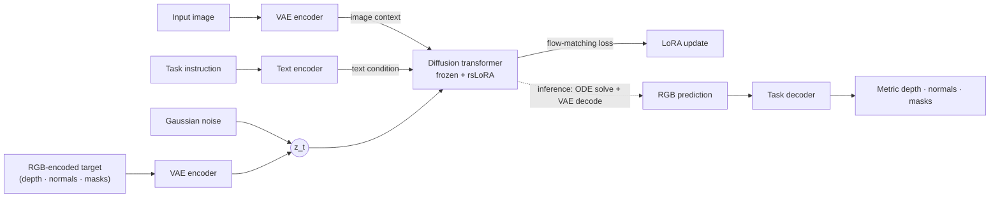

</details>

1. **Every task is an image.** Depth is passed through a power curve and painted along a path on the edges of the RGB cube; normals map linearly to RGB; segmentation classes, instances and referred objects are painted in prompt-specified colors.
2. **One generator, one adapter.** A pretrained image generator is instruction-tuned with rsLoRA on a mixture of vision-task pairs and its own generation / editing data, using the standard flow-matching loss. The diagram shows the instruction-editing layout used by Qwen-Image-2.1, where the input image is context and the target is generated from noise.
3. **Decoding has no learned parameters.** The predicted RGB image is inverted back to metric depth, unit normals or masks by the same mapping that produced the training targets.

---

## 📊 Results

Our numbers are measured with this repository's `scripts/evaluate_paper_benchmarks.py`. Raw metric δ1 (no scale alignment) is the headline metric; per-image aligned δ1 is a diagnostic only and is not comparable to the paper. Rows marked *closed reference* are the numbers reported in the paper, shown for comparison only.

### Fusion r64 runs (I108, external evaluation)

Two 100k-step LoRA arms on the fused Qwen-Image-2.1 base (`Melo111/Fusion-C1-KQ0r128-60-40`), rsLoRA r64, sampling mix depth 35 % / semantic 20 % / instance 20 % / referring 20 % / editing replay 5 % ([config](configs/experiments/fusion_r64_large_scale.yaml)). Arm A uses lr 3e-5 ([`ovb-i108-a-lr3e-5-r64-2x8-s42_20261109r3`](https://huggingface.co/khazic/ovb-i108-a-lr3e-5-r64-2x8-s42_20261109r3)), arm B lr 1e-5 ([`ovb-i108-b-lr1e-5-r64-2x8-s42_20261109r3`](https://huggingface.co/khazic/ovb-i108-b-lr1e-5-r64-2x8-s42_20261109r3)). Scores from [`khazic/ovb-i120-external-eval`](https://huggingface.co/khazic/ovb-i120-external-eval): 512 canvas, 50 steps, guidance 4.0, seed 42, native-resolution scoring (the target is generated from noise; `--strength` is ignored for this backbone). ReasonSeg here is n=344 (`query_mode=all`, `legacy_union` masks), so it is not directly comparable with the n=200 ReasonSeg column of the earlier runs below. Aligned δ1 in parentheses is a diagnostic only.

| Checkpoint | NYU δ1 | ETH3D δ1 | DIODE δ1 | Cityscapes mIoU | RefCOCOg cIoU | ReasonSeg gIoU |
|-----|-------:|---------:|---------:|----------------:|--------------:|---------------:|
| Fused base (no adapter) | 0.278 (0.873) | **0.292** (0.924) | 0.300 (0.844) | **0.386** | 0.466 | 0.417 |
| A, step 60k | 0.469 (0.901) | 0.258 (0.958) | 0.316 (0.890) | 0.276 | 0.438 | 0.357 |
| B, step 20k | 0.340 (0.903) | 0.166 (0.910) | 0.229 (0.888) | 0.353 | — | **0.440** |
| B, step 100k (final) | **0.497** (0.926) | 0.225 (0.974) | **0.353** (0.926) | 0.298 | **0.481** | 0.333 |
| *Vision Banana (closed reference, from the paper)* | *0.948* | *0.935* | *0.917* | *0.699* | *0.738* | *0.793* |

Longer training keeps raising NYU and DIODE δ1 while Cityscapes and ReasonSeg fall; no checkpoint beats the fused base on every benchmark. RefCOCOg is UMD val n=4896 from the same external evaluation (—: not scored). B 20k has no RefCOCOg score; B 17.5k, the balanced checkpoint, scores 0.518 in the merge evaluation below.

### LoRA merges of the B arm (I127, external evaluation)

Six exact ΔW-weighted merges of B `_best` EMA adapters, built by concatenating LoRA factors into one adapter (ΔW = Σ wᵢ · 8 · BᵢAᵢ) of rank 128, or 192 for the three-adapter P5; the fused base in P6 adds no factors. Same suite and settings as above, eval code `a8cc7e2`; RefCOCOg is UMD val n=4896. Results and adapters are in [`khazic/ovb-i127-merge-eval`](https://huggingface.co/khazic/ovb-i127-merge-eval), archived with per-file checksums in [`docs/evaluation/i127-merge-20261115/`](docs/evaluation/i127-merge-20261115/results.md).

| Model (recipe) | NYU δ1 | NYU AbsRel | ETH3D δ1 | Cityscapes mIoU | RefCOCOg cIoU | ReasonSeg gIoU |
|-----|-------:|-------:|---------:|----------------:|--------------:|---------------:|
| B 17.5k (control, rescored) | 0.407 | 0.294 | 0.176 | 0.355 | **0.518** | **0.431** |
| B 100k best | **0.485** | **0.267** | **0.221** | 0.293 | 0.482 | 0.333 |
| P1: 17.5k 75 % + 100k 25 % | 0.407 | 0.295 | 0.193 | 0.346 | 0.515 | 0.400 |
| P2: 17.5k 50 % + 100k 50 % | 0.419 | 0.288 | 0.198 | 0.338 | 0.506 | 0.380 |
| P3: 5k 60 % + 100k 40 % | 0.431 | 0.311 | 0.214 | 0.350 | 0.505 | 0.371 |
| P4: 20k 60 % + 100k 40 % | 0.394 | 0.320 | 0.203 | 0.339 | 0.517 | 0.385 |
| P5: 5k 40 % + 17.5k 40 % + 100k 20 % | 0.406 | 0.306 | 0.194 | **0.364** | 0.513 | 0.395 |
| P6: base 20 % + 17.5k 55 % + 100k 25 % | 0.449 | 0.324 | 0.200 | **0.364** | 0.512 | 0.400 |

Every merge improves ETH3D, and the three-way merges recover Cityscapes. But every merge loses 3–6 pp of ReasonSeg against the control, so none passes the pre-registered gates, and B 17.5k remains the balanced checkpoint. P2, P3 and P4 also give unstable DIODE AbsRel (1.1–2.9).

### Earlier Qwen-Image-2.1 runs

Metric depth δ1 without scale alignment, and segmentation metrics, at native ground-truth resolution: NYU n=654, ETH3D n=454, DIODE indoor n=325, Cityscapes n=500, RefCOCOg n=4896, ReasonSeg n=200. Checkpoint naming is explained under [Checkpoints](#checkpoints).

| Run | NYU δ1 | ETH3D δ1 | DIODE δ1 | Cityscapes mIoU | RefCOCOg cIoU | ReasonSeg gIoU |
|-----|-------:|---------:|---------:|----------------:|--------------:|---------------:|
| Parent (step 0) | 0.134 | 0.122 | 0.109 | 0.342 | 0.498 | **0.328** |
| C1: depth 75 %, cube-edge only | **0.348** | 0.233 | **0.321** | 0.346 | 0.424 | 0.303 |
| T0: all tasks + 10 % replay | 0.131 | 0.237 | 0.216 | 0.335 | 0.438 | 0.287 |
| T1: no normals | 0.149 | 0.192 | 0.180 | 0.337 | 0.467 | 0.271 |
| T2: depth 75 %, five colormaps | 0.179 | **0.251** | 0.241 | 0.331 | 0.291 | 0.276 |
| T3: segmentation specialist | 0.050 | 0.032 | 0.143 | 0.264 | 0.519 | 0.304 |
| ML: LoRA continued from the parent, T1 mixture, cube-edge | 0.169 | 0.227 | 0.246 | 0.354 | 0.489 | 0.304 |
| I101-h1: full fine-tune of the merged parent, T1 mixture, lr 5e-6 | 0.222 | 0.193 | 0.247 | 0.362 | 0.241 | 0.175 |
| Untuned Qwen-Image-2.1 (no adapter) | 0.072 | 0.119 | 0.077 | 0.215 | 0.376 | 0.254 |
| I102-i1: fresh LoRA on the untuned base, referring 35 % | 0.099 | 0.195 | 0.115 | **0.368** | **0.547** | 0.321 |
| Vision Banana (closed reference, from the paper) | 0.948 | 0.935 | 0.917 | 0.699 | 0.738 | 0.793 |

All rows except the last two start from the parent; I102-i1 starts from the untuned backbone. No run improves depth and segmentation together, and none beats the parent on every benchmark. At this budget, full fine-tuning (I101-h1) halves RefCOCOg against the matched LoRA run (ML). The depth gap is mostly absolute scale: with per-image median alignment the best δ1 rises to 0.845 / 0.906 / 0.855 on NYU / ETH3D / DIODE, but aligned δ1 is a diagnostic only and is not comparable to the paper's protocol.

<details>
<summary><b>Earlier SANA-1600M and FLUX.1-dev runs</b></summary>

These scores use the official splits, native ground-truth resolution, and the pixel-weighted metrics in `scripts/evaluate_paper_benchmarks.py`. They are not Table 1. `delta_1.25_aligned` is a per-image median-scale diagnostic. The depth gate requires metric δ1 at least 0.10 above the best non-oracle trivial baseline and AbsRel no worse than that baseline. Every depth row below failed that gate.

SANA relative depth, [`ovb-fix_ctrl_depth`](https://huggingface.co/khazic/ovb-fix_ctrl_depth) EMA, 20 steps, grayscale with bright=near:

| Dataset | n | δ1 | AbsRel | aligned δ1 |
|---------|--:|---:|-------:|-----------:|
| NYU Eigen + 10 m | 654 | 0.066 | 1.990 | 0.427 |
| DIODE indoor | 325 | 0.083 | 550.1 | 0.322 |
| KITTI Garg + 80 m | 1000 | 0.264 | 0.436 | 0.471 |
| ETH3D public DSLR + 80 m | 454 | 0.186 | 1.765 | 0.418 |
| iBims-1 | 100 | 0.101 | 229.5 | 0.345 |

SANA metric depth, local Hypersim cube-edge EMA (`sana_1600m_hypersim_metric_depth`, step 3000), 20 steps, no luminance invert:

| Dataset | n | δ1 | AbsRel | aligned δ1 |
|---------|--:|---:|-------:|-----------:|
| NYU Eigen + 10 m | 654 | 0.124 | 1.251 | 0.323 |
| DIODE indoor | 325 | 0.184 | 18.62 | 0.494 |
| KITTI Garg + 80 m | 1000 | 0.051 | 0.773 | 0.241 |
| ETH3D public DSLR + 80 m | 454 | 0.292 | 0.543 | 0.486 |
| iBims-1 | 100 | 0.179 | 23.02 | 0.393 |

SANA normals, [`ovb-fix_ctrl_normal`](https://huggingface.co/khazic/ovb-fix_ctrl_normal) EMA, DIODE indoor n=325: mean angle 24.96°, median 17.01°. Both normal gates passed. This is not the paper's 13.818°. NYU, ScanNet and VKITTI normal maps are not in the eval tree.

SANA referring, [`ovb-fix_seg_plus_gcg`](https://huggingface.co/khazic/ovb-fix_seg_plus_gcg) step-30000 adapter (no EMA), RefCOCOg UMD val n=4896: cIoU 0.143, gIoU 0.158, Precision@0.5 0.089. The paper's cIoU is 0.738. Cityscapes semantic mIoU was not measured for the SANA runs.

FLUX.1-dev specialist `ovb-flux3_ctrl_depth_nominsnr_15k`, 20 steps, 4-bit, closer-brighter grayscale:

| Dataset | n | δ1 | AbsRel | aligned δ1 |
|---------|--:|---:|-------:|-----------:|
| NYU Eigen + 10 m | 654 | 0.155 | 1.472 | 0.202 |
| DIODE indoor | 325 | 0.140 | 2433 | 0.219 |
| KITTI Garg + 80 m | 1000 | 0.095 | 0.778 | 0.178 |
| ETH3D public DSLR + 80 m | 454 | 0.163 | 1.398 | 0.206 |
| iBims-1 | 100 | 0.179 | 2096 | 0.206 |

FLUX.1-dev specialist `ovb-flux3_ctrl_normal_nominsnr_15k`, DIODE indoor n=325: mean angle 91.09°, median 91.51°. That is chance-level orientation, not the paper's 13.818°.

FLUX.1 Kontext Hypersim metric EMA finished 3000/3000 (`flow_loss=0.1526`). Its NYU official_test result is not reported here. `ovb-flux3_ctrl_seg_nominsnr_15k` has no Cityscapes `gtFine` here, so semantic mIoU is not measured.

</details>

Paper reference numbers and the per-benchmark status table are in [Benchmarks (from paper)](#benchmarks-from-paper).

---

## 🚀 Quick Start

### Installation

```bash
git clone https://github.com/isLinXu/open-vision-banana.git
cd open-vision-banana

# Core only (no GPU dependencies)
pip install -e .

# With inference support (requires GPU)
pip install -e ".[inference]"

# With training support
pip install -e ".[training]"

# Full installation (all features)
pip install -e ".[all]"
```

### Core algorithms (no GPU required)

```python
import torch
from open_vision_banana.core import DepthRGBMapper, NormalRGBMapper, SegmentationDecoder

# Metric depth -> RGB (power curve + RGB-cube-edge colormap) -> metric depth
mapper = DepthRGBMapper()                      # λ = -3, c = 10/3, cube_edge
depth = torch.rand(1, 1, 512, 512) * 50.0      # metres
rgb = mapper.depth_to_rgb(depth)
recovered = mapper.rgb_to_depth(rgb)           # max relative error < 1e-3

# Unit normals <-> RGB
normal_mapper = NormalRGBMapper()
normal = torch.nn.functional.normalize(torch.randn(1, 3, 512, 512), dim=1)
normal_rgb = normal_mapper.normal_to_rgb(normal)

# Instance masks from a "one colour per instance" RGB image (Appendix A decoder)
instances = SegmentationDecoder().decode_instance(rgb)
```

### Inference (GPU)

```python
import torch
from PIL import Image
import torchvision.transforms.functional as TF
from open_vision_banana import VisionBanana

model = VisionBanana.from_pretrained(
    model_name="qwen-image-2.1",              # the default is FLUX.1-schnell, so set it explicitly
    lora_path="path/to/checkpoint",           # local dir, hf:repo/id or registry:alias
    # enable_sequential_cpu_offload=True,     # for ~16 GB GPUs
)

image = TF.to_tensor(Image.open("input.jpg").convert("RGB")).unsqueeze(0) * 2 - 1  # [1,3,H,W] in [-1,1]
result = model.predict(image=image, task="depth",
                       num_inference_steps=50, guidance_scale=4.0, seed=42)
```

> [!NOTE]
> `predict()` defaults to `num_inference_steps=1` and `guidance_scale=0`, which are smoke-test settings. Pass the evaluation settings explicitly, as above. The values the published results use are 512 px, 50 steps and guidance 4.0.

### Command line

```bash
# List the registry aliases (the generic `vision-banana*` aliases are placeholders without weights)
python scripts/download_checkpoint.py --list

# Single-image inference (this script has no CFG option, so guidance stays 0)
python scripts/inference.py --image input.jpg --task depth \
  --model-name qwen-image-2.1 --lora-path path/to/checkpoint --steps 50 \
  --cpu-offload --vae-slicing

# SANA multi-task visualization on a manifest's val split (input / target / prediction)
python scripts/infer_sana_512.py \
  --data-dir /path/to/dataset --pair-manifest /path/to/pairs.jsonl \
  --checkpoint path/to/checkpoint/lora.pt \
  --model-name sana-1600m --lora-rank 32 --lora-alpha 64 \
  --num-inference-steps 20 --output-dir output/infer_sana
```

For benchmark numbers use [`scripts/evaluate_paper_benchmarks.py`](#evaluation--export), which exposes every protocol setting.

---

## Models

Trained end to end with the unified trainer and published on the Hub:

| Model | `model_name` | Notes |
|-------|--------------|-------|
| Qwen-Image-2.1 (7B) | `qwen-image-2.1` | Current main line; instruction-editing layout |
| SANA-1600M | `sana-1600m` | Earlier runs; text-to-image backbone |
| FLUX.1-dev (12B) | `flux-dev` | Earlier runs; 4-bit quantized transformer |

<details>
<summary><b>Other registered base models (not trained end to end here)</b></summary>

The registry (`src/open_vision_banana/model_registry.py`) holds 40+ configurations across 29 families. A few of the text-to-image ones:

| Model | `model_name` | Size |
|-------|--------------|------|
| FLUX.1-schnell | `flux-schnell` | 12B |
| Z-Image | `z-image` | 6B |
| Qwen-Image | `qwen-image` | 20B |
| SANA-600M | `sana-600m` | 600M |
| Lumina-Image-2.0 | `lumina2` | 2B |
| Chroma1-HD | `chroma` | 8.9B |

Licenses differ between base models (FLUX.1-dev and FLUX.1 Kontext are non-commercial); check each model card before use.

</details>

<details>
<summary><b>Instruction-editing models</b></summary>

These checkpoints take a source image plus an instruction. Each one has a training forward that follows that model's official conditioning. The diffusers classes have been executed at tiny width. A full fine-tune of those Hub checkpoints has not been run, except the in-progress FLUX.1 Kontext depth run.

| Name | Pipeline | Notes |
|------|----------|--------|
| `flux-kontext` | `FluxKontextPipeline` | In-context tokens. Non-commercial. |
| `qwen-image-edit`, `qwen-image-edit-2509` | Qwen edit / edit-plus | Packed 2×2 latents. Text encoding does not insert the VL image tokens. |
| `longcat-image-edit` | `LongCatImageEditPipeline` | Packed tokens, modality 2 for the source. |
| `flux2-klein` | `Flux2KleinPipeline` | Flattened reference tokens. |
| `joyimage-edit`, `joyimage-edit-plus` | Joy image slots | Text encoding does not insert VL image tokens. |
| `instruct-pix2pix`, `sdxl-instruct-pix2pix` | InstructPix2Pix | Source channels concatenated. `image_guidance_scale` stays 1.5. |
| `hunyuan-image3-instruct`, `hunyuan-image3-instruct-distil` | `generate_image` | 80B MoE. The checkpoint directory name cannot contain `.`. Training calls `prepare_model_inputs`. |

`hunyuan-image` stays the HunyuanImage 2.1 text-to-image pipeline.

</details>

---

## Training

> 📖 **GPU Training Guide**: See [`docs/quick-start.md`](docs/quick-start.md) for H20 / A100 / RTX quick-start with copy-paste commands.

For supervised referring expression segmentation, see the [RES data and evaluation guide](docs/res_data.md): validated RefCOCO-family data, a versioned binary mask contract, a pinned Hugging Face release, and native-resolution evaluation.

For category-conditioned semantic and instance supervision, see the [COCONut-B supplement](docs/coconut_segmentation.md): source-verified masks, explicit class/color prompts, held-out COCO ID filtering, portable data bundles, and sampled target visualizations.

### Paper-aligned recipe (recommended)

The paper's regime is instruction-tuning a *natively image-conditioned* generator on
its own generation/editing data mixed with a low share of vision-task data. The
closest open backbones are Qwen-Image-2.1 / Qwen-Image-Edit (source image enters as
VLM visual tokens + reference latents). Starting from public data:

```bash
bash scripts/download_datasets.sh --group train                 # Hypersim, TartanAir, ADE20K, COCO+LVIS, RefCOCO(+)
bash scripts/download_datasets.sh --only omniedit                # generation replay (group replay, not in --group train)
# ... per-source prepare scripts, then merge + zero-shot audit (docs/DATASETS.md)
PYTHONPATH=src python scripts/train.py \
  --config configs/experiments/qwen_image_21_paper_aligned.yaml \
  --pair-manifest data/qwen_baseline/pairs.jsonl --data-dir data/qwen_baseline --wandb
```

The recipe trains six tasks (`depth, normal, semantic, instance, referring, generation`)
with `vision_ratio: 0.5`, multi-colormap depth targets, all four Fig. 2 semantic prompt
styles with on-the-fly colour remapping, the Fig. 3 / Fig. 4 instance and referring
prompts, aspect-preserving crops and rsLoRA r32/α64. Every run writes
`effective_config.json`; values the paper does not state (optimizer, lr, ratio, …) are
marked as repository choices in the config comments.

For the pinned LingBot 50k supplement, see the [full-pool depth experiment plan](docs/lingbot_full_data_experiments.md):
paired D/P/M configurations, strict data preparation, audited launches and benchmark protocols.
These are experiment recipes, not claims of improved model results.

For real indoor depth pairs from ARKitScenes, DIODE and non-NYU SUN RGB-D, see
the [observed-depth supplement](docs/indoor_depth_observed98.md). Preparation
requires >=98% native observed pixels, preserves official held-out splits and
uses the existing training format without changing training code.

### Unified Training Framework

`scripts/train.py` is one entry point for all registered models (Qwen-Image, SANA,
FLUX, SD3, instruction editors) and any task mixture:

```bash
# SANA-1600M 3-task (text-to-image backbone; the original SNVC ablation baseline)
PYTHONPATH=src python scripts/train.py \
  --config configs/sana_1600m_3task_full_clean.yaml --wandb

# Override any config parameter via CLI
PYTHONPATH=src python scripts/train.py \
  --config configs/experiments/qwen_image_21_paper_aligned.yaml \
  --steps 10000 --lr 5e-5 --output-dir output/custom_run

# Continue from an earlier LoRA on new data (fresh optimizer / schedule / step)
PYTHONPATH=src python scripts/train.py --config <yaml> \
  --resume output/<run>/checkpoint-<N> --resume-weights-only
```

The framework consists of modular components:

| Module | File | Description |
|--------|------|-------------|
| `ModelBackend` | `training/model_backend.py` | Model abstraction (quantization, LoRA, packing, forward) |
| `FlowScheduler` | `training/flow_matching.py` | Unified flow matching (SANA linear_flow + rectified-flow) |
| `TrainingConfig` | `training/config.py` | YAML config + CLI overrides via dataclass |
| `TrainingLosses` | `training/losses.py` | Flow MSE + Min-SNR + task weighting + aux losses |
| `TrainingCallbacks` | `training/callbacks.py` | W&B logging + checkpoint + validation tracking |
| `Trainer` | `training/trainer.py` | Core training loop assembling all modules |

### Data Preparation

One-command fetch of every public source in the paper-aligned recipe (registry:
`configs/datasets/sources.tsv`; details and the download → prepare → train path in
[`docs/DATASETS.md`](docs/DATASETS.md)):

```bash
bash scripts/download_datasets.sh --list              # registered sources, grouped train / eval / replay
bash scripts/download_datasets.sh --group train       # Hypersim, TartanAir, ADE20K, COCO+LVIS, RefCOCO(+), ...
bash scripts/download_datasets.sh --only omniedit     # generation replay shards
```

Legacy per-dataset helpers:

```bash
# List all supported datasets
python scripts/download_data.py --list

# Download and prepare a dataset
python scripts/download_data.py --dataset hypersim-depth --output data/hypersim/

# Validate before training
python scripts/validate_dataset.py --data-path data/hypersim_depth/ --task depth
```

<details>
<summary><b>Hardware-specific launchers</b></summary>

| GPU | VRAM | Launcher |
|-----|------|----------|
| H20 | 96GB | `bash scripts/launch_h20_single.sh` |
| H20 ×8 | 96GB×8 | `bash scripts/launch_h20_ddp.sh` |
| A100-80GB | 80GB | `bash scripts/launch_training_a100_80g.sh` |
| A100-40GB | 40GB | `bash scripts/train_a100_40g_deepspeed.sh` |
| RTX 4090 | 24GB | `PYTHONPATH=src python scripts/train.py --config <yaml>` |
| MPS (Apple) | Unified | `PYTHONPATH=src python scripts/train.py --config <yaml>` |

</details>

<details>
<summary><b>Legacy model-specific training scripts</b></summary>

Model-specific scripts are preserved for reference and backward compatibility:

```bash
# SANA training (legacy)
PYTHONPATH=src python scripts/train_sana_512.py \
  --config configs/sana_1600m_3task.yaml

# FLUX training (legacy)
PYTHONPATH=src python scripts/train_flux.py \
  --config configs/flux_3task_full_clean.yaml --wandb
```

</details>

<details>
<summary><b>Inference optimization presets</b></summary>

| Preset | Target VRAM | Speed | Quality | Key Options |
|--------|-------------|:-----:|:-------:|-------------|
| `balanced` | ~16 GB | ★★★ | ★★★★ | float16 + model_cpu_offload + VAE slicing |
| `speed` | ~20 GB | ★★★★★ | ★★★ | float16 + torch.compile + VAE tiling |
| `memory` | ~8 GB | ★★ | ★★★ | float16 + sequential offload + INT8 mappers |
| `quality` | ~40 GB | ★★★ | ★★★★★ | bfloat16 + max-autotune compile |
| `cpu` | RAM only | ★ | ★★★ | float32 + sequential offload |

Profiles live in `configs/optimization_presets.yaml`: `python scripts/optimize_inference.py --list-presets`, then `--profile <name>`.

</details>

---

## Supported Tasks

| Task | RGB encoding | Encoder / decoder | Public-data training pipeline |
|------|--------------|:-----------------:|:---------------------:|
| Metric Depth Estimation | Power transform + colormap (cube-edge, plasma, inferno, viridis, grayscale, rainbow, turbo) | ✅ | ✅ |
| Surface Normal Estimation | Direct linear mapping (x,y,z) → (R,G,B) | ✅ | ✅ |
| Semantic Segmentation | Color mapping: `{"cat": "red", "background": "yellow"}` | ✅ | ✅ |
| Instance Segmentation | "Each dog is colored differently" | ✅ | ✅ |
| Referring Expression Segmentation | "The man in pink t shirt is rendered solid white" | ✅ | ✅ |
| Edge Detection | "Edges are white, background is black" | ✅ | — |
| Optical Flow | HSV encoding: direction=hue, magnitude=saturation | ✅ | — |
| 2D Keypoint Detection | Colored dots per keypoint type | ✅ | — |
| Object Detection | Colored bounding box per class | ✅ | — |
| Depth Edge Detection | Depth discontinuity → white edges | ✅ | — |

The first five rows are the paper's tasks and have a verified public-data pipeline
(download → prepare → merge → zero-shot audit → `Trainer`, see
[`docs/DATASETS.md`](docs/DATASETS.md)) plus a sixth `generation` task for the
paper's generation-preservation mixing. The remaining rows have RGB encoders /
decoders and inference wiring but no curated training source in this repository.

---

## Key Algorithms

### 1. Depth → RGB Mapping

Maps metric depth [0, ∞) to [0, 1] with a **power transform**, which with the paper's parameters is u(d) = 1 − (1 + d/10)^−2:

```
f(d, λ, c) = 1 - (1 - d/(λc))^(λ+1)
```

Then paints u along the **edges of the RGB cube**, the first-order 3D Hilbert path (black → red → yellow → green → cyan → blue → magenta → white) with piecewise-linear interpolation.

**Parameters**: λ=-3, c=10/3

### 2. Normal → RGB Mapping

Camera-space normals (right-handed: +x right, +y up, +z toward camera):

```
R = (1-x)/2,  G = (1+y)/2,  B = (1+z)/2
```

### 3. Instance Segmentation Decoding

5-stage clustering from Appendix A of the paper:

1. **Background Initialization** — τ=14 color tolerance
2. **Color Similarity Grouping** — seed-based grouping with 16-connectivity (paper Eq. 3), implemented with Union-Find; an `adjacent` grouping mode is available as an alternative
3. **Noise Pruning** — θ_size = 2×10⁻⁴
4. **Boundary Artifact Elimination** — 3×3 erosion, θ_erosion=0.1
5. **Spatially Constrained Merging** — γ=5.0

### 4. Instruction Tuning (rsLoRA)

- rsLoRA (scale α/√r) on the attention and image-MLP projections: r32/α64 in the paper-aligned recipe, r64/α64 in the Fusion r64 runs, about 1.2 % / 2.4 % of the 7B Qwen-Image-2.1 transformer
- The share of vision-task samples is a repository choice set by `vision_ratio` (0.5 paper-aligned, 0.9 Fusion r64); the paper only says the vision data is a small amount
- Generation or editing replay is mixed in to preserve generation; retention has not been measured here (the paper reports human win rates of 53.5 % / 47.8 % against its base model)

---

## Checkpoints

Published LoRAs are at [`khazic/ovb-*`](https://huggingface.co/khazic?search=ovb-). The repo id is `khazic/ovb-<run>`. The full list of published weights, pinned revisions, the README row each repo belongs to, and download commands is in [`MODEL_CARD.md`](MODEL_CARD.md#published-checkpoints).

| Name pattern | Base | What to load |
|--------------|------|----------------|
| `ovb-i88_*`, `ovb-ft_*`, `ovb-i97-*` | Qwen-Image-2.1 | `checkpoint-*_final`; `metadata.json` records `model_name: qwen-image-2.1` |
| `ovb-i108-*` | Qwen-Image-2.1 on the fused base [`Melo111/Fusion-C1-KQ0r128-60-40`](https://huggingface.co/Melo111/Fusion-C1-KQ0r128-60-40) | `ckpt/checkpoint-N_best` (EMA adapter), `ckpt/checkpoint-N` or `ckpt/checkpoint-100000_final`; download a single folder with `--include` (each repo is ~200 GB) |
| `ovb-fix_*`, `ovb-best3_*`, `ovb-ctrl_*`, `ovb-main_*` | SANA-1600M | `checkpoint-*_final` (prefer `ema_adapter` when that directory exists) |
| `ovb-flux*`, `ovb-flux2*`, `ovb-flux3*`, `ovb-flux4*` | FLUX.1-dev | same layout; `metadata.json` records `model_name: flux-dev` |

The earlier Qwen-Image-2.1 runs in [Results](#-results) are published under `khazic/ovb-i88_*` and `khazic/ovb-ft_*` (the table above maps the prefixes to backbones), and the I108 arms are linked in that section. Exact run names and per-run metrics are also rendered from the evaluation JSONs in [`demo/`](demo/) and [`website/`](website/).

SANA / FLUX task-matched runs (as of 2026-11-15 these `ovb-fix_*` and `ovb-flux3_*` repositories return 404 on the Hub, so the weights cannot be downloaded; the numbers are kept as a record):

- Depth: [`ovb-fix_ctrl_depth`](https://huggingface.co/khazic/ovb-fix_ctrl_depth), [`ovb-flux3_ctrl_depth_nominsnr_15k`](https://huggingface.co/khazic/ovb-flux3_ctrl_depth_nominsnr_15k)
- Normals: [`ovb-fix_ctrl_normal`](https://huggingface.co/khazic/ovb-fix_ctrl_normal), [`ovb-flux3_ctrl_normal_nominsnr_15k`](https://huggingface.co/khazic/ovb-flux3_ctrl_normal_nominsnr_15k)
- Semantic / referring: [`ovb-fix_ctrl_seg`](https://huggingface.co/khazic/ovb-fix_ctrl_seg), [`ovb-fix_seg_plus_gcg`](https://huggingface.co/khazic/ovb-fix_seg_plus_gcg), [`ovb-flux3_ctrl_seg_nominsnr_15k`](https://huggingface.co/khazic/ovb-flux3_ctrl_seg_nominsnr_15k)

The `fix_*` depth LoRAs were trained as closer-brighter grayscale. Decode them with `--depth-colormap grayscale --invert-depth`. A separate local SANA-1600M Hypersim run (cube-edge metric metres, not a Hub `ovb-*` repo) is listed separately.

---

## Paper Alignment Statement

> Line-by-line audit against the paper text (58 checkable statements, per-item status and code locations): [`docs/PAPER_ALIGNMENT_AUDIT_2026-10-22.md`](docs/PAPER_ALIGNMENT_AUDIT_2026-10-22.md).

> What "aligned with the paper" means here, and what it cannot mean. Audited on 2026-10-22 against arXiv:2604.20329v3 (Sections 2–3, Appendix A–D). Details and line references: [`docs/ABLATION_BASELINE.md`](docs/ABLATION_BASELINE.md).

**Three categories, kept separate on purpose:**

1. **Stated by the paper and matched here (method-level, ~96%).** Every formula, constant, prompt string and evaluation protocol the paper writes down has a one-to-one implementation:
   depth power transform (λ = −3, c = 10/3) and the cube-edge colormap with its analytic inverse (`core/depth_mapper.py`); normal mapping R=(1−x)/2, G=(1+y)/2, B=(1+z)/2 (`core/normal_mapper.py`); the four semantic prompt styles of Fig. 2, the instance prompts of Fig. 3 and the referring prompts of Fig. 4, verbatim (`inference/prompt.py`, `referring_contract.py`); the five-stage instance decoder of Appendix A with τ = 14, θ_size = 2×10⁻⁴, θ_erosion = 0.1, γ = 5, 16-connectivity (`core/segmentation/`); the SA-Co cgF1 = 100·pmF1·IL_MCC with the Gemini 3.1 Flash-Lite presence prompt and the single-turn Gemini 2.5 Pro ReasonSeg rewrite (`evaluation/instance.py`, `evaluation/gemini.py`); metric depth evaluated without scale alignment or intrinsics; the five tasks, low-ratio mixing with generation data, and the zero-shot rule that no evaluation benchmark enters training (path- and image-id-level audits in `scripts/build_qwen_baseline_manifest.py`). The only remaining items the paper shows but does not benchmark are covered as optional training data (Fig. 4 (a)/(b) multi-expression rows). Two readings the paper leaves open — Eq. (3) seed comparison and the Eq. (6) area basis — are exposed as `seed_merge_rule` / `spatial_merge_area_basis` with the paper-literal reading as default.

2. **Not stated by the paper; chosen here and recorded.** The paper gives no architecture, optimizer, learning rate, schedule, batch size, warmup, weight decay, gradient clipping, loss form, loss weights, mixing ratio, seed, resolution, inference steps or CFG, and no benchmark depth caps/crops. The values in `configs/experiments/*_paper_aligned.yaml` (AdamW 1e-4, rsLoRA r32/α64, 512 px, `vision_ratio` 0.5, NYU 10 m Eigen / KITTI 80 m Garg, …) are this repository's choices, written to `effective_config.json` per run and marked "not a paper constant" in the config comments. They can be reproduced, but they cannot be "aligned".

3. **Closed, not reproducible by any open implementation.** The Nano Banana Pro base model, the in-house 2D annotations and internal 3D renders, and the human pairwise generation study (GenAI-Bench 53.5 % / ImgEdit 47.8 %). This repository substitutes Qwen-Image-2.1 / Qwen-Image-Edit, public data (SNVC, Hypersim, TartanAir, BlendedMVS, COCO, LVIS, Rea2Seg) and an FID/LPIPS proxy that can only show the absence of severe generation degradation. **The paper's benchmark numbers are therefore not a target of this repository and are reported in the next section for reference only.**

---

## Benchmarks (from paper)

> These are the **paper's** numbers (Nano Banana Pro base, undisclosed in-house data). This repository has **not** reproduced them. Measured scores are in [Results](#-results); older gates and blocked benches are in [`docs/EXPERIMENTAL_RESULTS_2026-10-10.md`](docs/EXPERIMENTAL_RESULTS_2026-10-10.md).

| Task | Benchmark | Metric | Vision Banana | Previous SOTA |
|------|-----------|:------:|:-------------:|:-------------:|
| Semantic Seg | Cityscapes | mIoU | **69.9** | 65.2 (SAM 3) |
| Instance Seg | SA-Co/Gold | cgF1 | **47.5** | 24.6 (OWLv2) |
| Referring Seg | RefCOCOg | cIoU | **73.8** | 73.4 (SAM 3 + Gemini 2.5 Pro) |
| Referring Seg | ReasonSeg | gIoU | **79.3** | 77.0 (SAM 3 + Gemini 2.5 Pro) |
| Depth | 6-dataset avg | δ1↑ | **0.882** | 0.823 (UniK3D) |
| Depth | 4-dataset avg (NYU/ETH3D/DIODE/KITTI) | δ1↑ | **0.929** | 0.918 (Depth Anything 3) |
| Normal | 4-dataset avg | mean°↓ | **18.928** | 19.642 (Lotus-2) |

<details>
<summary><b>Per-benchmark status of this repository</b></summary>

The paper evaluates three axes. This table is the current measured-or-blocked status, not Table 1. Paper numbers stay in the left column only.

| Axis | Benchmark | Paper | This repo | Status |
|------|-----------|------:|-----------|--------|
| 2D | RefCOCOg UMD val cIoU | 0.738 | Qwen-Image-2.1 I102-i1 0.547, I108 B-17.5k 0.518; SANA `ovb-fix_seg_plus_gcg` 0.143 (n=4896) | measured |
| 2D | ReasonSeg val gIoU | 0.793 | Qwen-Image-2.1 I108 B-20k 0.440 (n=344, all queries); parent 0.328 (n=200) | measured (n=344 and n=200); not directly comparable. Paper score uses Gemini 2.5 Pro query rewrite |
| 2D | Cityscapes val mIoU | 0.699 | Qwen-Image-2.1 fused base 0.386; I102-i1 0.368 (n=500) | measured. Do not use `cityscapes8` |
| 2D | SA-Co/Gold cgF1 | 47.5 | — | adapter ready (query JSONL + pmF1/IL_MCC/cgF1). Dataset not present. Paper score uses Gemini 3.1 Flash-Lite NP filter |
| 3D depth | NYU δ1 / AbsRel | 0.948 / 0.081 | Qwen-Image-2.1 I108 B-100k δ1 0.497; C1 0.348; SANA gray 0.066 / 1.990; SANA metric 0.124 / 1.251; FLUX gray 0.155 / 1.472 | measured, gate fail |
| 3D depth | iBims-1 | 0.934 / 0.078 | SANA gray 0.101; SANA metric 0.179; FLUX gray 0.179 | measured, gate fail |
| 3D depth | ETH3D | 0.935 / 0.103 | Qwen-Image-2.1 fused base δ1 0.292; T2 0.251; SANA gray 0.186; SANA metric 0.292; FLUX gray 0.163 | measured, gate fail |
| 3D depth | DIODE-Indoor | 0.917 / 0.108 | Qwen-Image-2.1 I108 B-100k δ1 0.353; C1 0.321; SANA gray 0.083; SANA metric 0.184; FLUX gray 0.140 | measured, gate fail |
| 3D depth | KITTI | 0.915 / 0.107 | SANA gray 0.264; SANA metric 0.051; FLUX gray 0.095 | measured, gate fail |
| 3D depth | nuScenes | 0.643 / 0.219 | — | adapter now returns metric `gt_depth` (80 m cap, no paper crop). LiDAR projections not on the eval machine |
| 3D normal | DIODE-Indoor mean° | 13.818 | SANA 24.96 (gates pass); FLUX 91.09 | measured |
| 3D normal | NYU / ScanNet / VKITTI | 17.778 / 15.052 / 29.063 | — | official normal maps not in the eval tree |
| Generation | GenAI-Bench T2I win | 53.5% | — | paper metric is human pairwise. Prompt adapter ready; no human judge run |
| Generation | ImgEdit win | 47.8% | — | paper metric is human pairwise. Instruction-pair adapter ready; no human judge run |

`--benchmark 2d|3d|generation|all` now groups those jobs. ReasonSeg, SA-Co/Gold, nuScenes, GenAI-Bench, and ImgEdit roots are `--reasonseg-root`, `--saco-root`, `--nuscenes-root`, `--genai-bench-root`, `--imgedit-root`.

</details>

---

## Evaluation & Export

### Evaluation

```python
from open_vision_banana.evaluation import evaluate_depth, evaluate_normals

# Depth metrics
metrics = evaluate_depth(pred_depth, gt_depth)
# → {"AbsRel": ..., "SqRel": ..., "RMSE": ..., "RMSE_log": ..., "δ<1.25": ..., ...}

# Normal metrics
metrics = evaluate_normals(pred_normals, gt_normals)
# → {"Mean Angular Error (°)": ..., "Median Angular Error (°)": ..., "Mean Cosine Similarity": ..., "11.25° Accuracy": ...}
```

Paper-protocol eval scores a decoded task against the official split at native ground-truth resolution. Relative grayscale depth LoRAs need the invert flags. Metric cube-edge checkpoints omit them.

```bash
# Qwen-Image-2.1 with the protocol of the published results (the defaults of 1 step and
# guidance 0 are smoke settings; always pass them explicitly)
PYTHONPATH=src python scripts/evaluate_paper_benchmarks.py \
  --benchmark depth --model-name qwen-image-2.1 --lora-path path/to/checkpoint \
  --dtype bfloat16 --resolution 512 --num-inference-steps 50 --guidance-scale 4.0 \
  --seed 42 --native-resolution \
  --nyu-root data/nyu/official_test --output-json output/eval/nyu.json

# SANA relative-depth LoRA (closer-brighter grayscale)
PYTHONPATH=src python scripts/evaluate_paper_benchmarks.py \
  --benchmark depth --model-name sana-1600m \
  --lora-path checkpoints/ovb-fix_ctrl_depth/ema_adapter \
  --dtype float32 --native-resolution --num-inference-steps 20 \
  --depth-colormap grayscale --invert-depth \
  --nyu-root data/nyu/official_test \
  --output-json output/eval/nyu_fix_ctrl_depth.json

PYTHONPATH=src python scripts/check_depth_gate.py \
  --model-json output/eval/nyu_fix_ctrl_depth.json --benchmark depth/nyu \
  --baseline-json output/eval/nyu_trivial.json

# FLUX.1-dev on a 24 GB GPU (4-bit transformer + 8-bit T5)
PYTHONPATH=src python scripts/evaluate_paper_benchmarks.py \
  --benchmark depth --model-name flux-dev --quantize 4bit \
  --lora-path checkpoints/ovb-flux3_ctrl_depth/lora_adapter \
  --dtype bfloat16 --native-resolution --num-inference-steps 20 \
  --depth-colormap grayscale --invert-depth \
  --nyu-root data/nyu/official_test \
  --output-json output/eval/nyu_flux3_ctrl_depth.json
```

Capability groups: `--benchmark 2d` (Cityscapes, RefCOCOg, ReasonSeg, SA-Co/Gold), `--benchmark 3d` (NYU, iBims, ETH3D, DIODE-Indoor, KITTI, nuScenes, plus normals), `--benchmark generation` (GenAI-Bench / ImgEdit proxies). Single-task flags still work. Normals use `--benchmark normal`. Referring uses `--refcocog-root` and `--reasonseg-root`. Instance uses `--saco-root`. Semantic Cityscapes uses `--cityscapes-root`.

### Export

```python
from open_vision_banana.export import export_mapper_onnx

# Export depth/normal mappers to ONNX
export_mapper_onnx("depth_to_rgb", "depth_mapper.onnx")
export_mapper_onnx("normal_to_rgb", "normal_mapper.onnx")
```

---

## Docker

```bash
# CPU image (core algorithms, inference)
docker build -t open-vision-banana:latest -f docker/Dockerfile .

# GPU image (training + CUDA inference)
docker build -t open-vision-banana:gpu -f docker/Dockerfile.gpu .

# Docker Compose
docker compose -f docker/docker-compose.yml up dev      # editable CPU dev
docker compose -f docker/docker-compose.yml up training # GPU FSDP training
docker compose -f docker/docker-compose.yml up notebook # Jupyter on :8888
```

Interactive Colab demo: [`notebooks/colab_demo.ipynb`](notebooks/colab_demo.ipynb)

---

## Project Structure

<details>
<summary><b>Directory layout</b></summary>

```
open-vision-banana/
├── src/open_vision_banana/
│   ├── core/                    # Core algorithms (no external deps)
│   │   ├── depth_mapper.py      # Power transform + 7 colormaps
│   │   ├── adaptive_depth_mapper.py
│   │   ├── normal_mapper.py     # Linear normal ↔ RGB mapping
│   │   ├── segmentation/        # 5-stage instance segmentation decoder
│   │   ├── edge_mapper.py       # Edge detection
│   │   ├── flow_mapper.py       # Optical flow HSV encoding
│   │   ├── keypoint_mapper.py   # 2D keypoint detection
│   │   ├── object_detection_mapper.py
│   │   ├── depth_edge_mapper.py
│   │   ├── union_find.py        # Union-Find (path compression)
│   │   └── rgb_mapper.py        # Unified encode/decode interface
│   ├── inference/               # Model loading and generation
│   │   ├── generator.py         # Multi-model + LoRA wrapper
│   │   ├── pipeline.py          # VisionBanana unified model
│   │   ├── prompt.py            # Task-specific prompt builder
│   │   ├── decoder.py           # Visualization decoder
│   │   └── optimization.py      # Inference optimization presets
│   ├── training/                # Unified training framework
│   │   ├── model_backend.py     # Multi-model abstraction (SANA/FLUX/SD3)
│   │   ├── flow_matching.py     # Unified flow matching scheduler
│   │   ├── config.py            # YAML config + CLI overrides
│   │   ├── losses.py            # Flow MSE + Min-SNR + aux losses
│   │   ├── callbacks.py         # W&B logging + checkpoint
│   │   ├── trainer.py           # Core training loop
│   │   ├── edit_forward.py      # Instruction-editor training layouts
│   │   ├── tuner.py             # Legacy InstructionTuner
│   │   ├── trainer_interface.py # 5 backends (Native/DDP/FSDP/DeepSpeed/Accelerate)
│   │   └── ...
│   ├── evaluation/              # Metrics, paper benchmark protocols, depth/normal gates
│   ├── export/                  # ONNX + TorchScript export
│   ├── referring_contract.py    # Fig. 4 (c)/(d) referring prompt shared by data / inference / eval
│   └── data/                    # Dataset adapters + pipeline helpers
│       ├── hypersim.py          # Hypersim normals / NYU40 semantics / instances -> paper RGB targets
│       ├── depth_geometry.py    # Hypersim ray distance -> planar z-depth
│       ├── instance_palette.py  # Instance colours (>= 60 apart) for COCO/LVIS + Hypersim builders
│       └── openvocab_semantic.py# Fig. 2 prompt styles, sampler, prompt -> mapping parser
├── configs/                     # Training & experiment configs
│   ├── experiments/*_paper_aligned.yaml   # Six-task paper-aligned recipes (Qwen-Image-2.1 / -Edit)
│   └── datasets/sources.tsv     # Dataset registry read by scripts/download_datasets.sh
├── docs/DATASETS.md             # download -> prepare -> merge -> audit -> train
├── scripts/                     # Training, inference, evaluation, data pipeline scripts
│   ├── download_datasets.sh     # One-command fetch from ModelScope / HF / URL
│   ├── prepare_hypersim.py      # depth + normal + semantic + instance from one Hypersim scene
│   ├── build_instance_manifest.py / build_res_manifest.py / build_generation_replay_manifest.py
│   ├── merge_multitask_manifest.py / build_qwen_baseline_manifest.py   # merge + zero-shot audit
│   └── evaluate_paper_benchmarks.py       # Tables 2-7 protocols
├── tests/                       # 2000+ tests across 160+ files (incl. pipeline smoke + Trainer system tests)
├── docker/                      # CPU/GPU Docker images
└── notebooks/                   # Colab demo
```

</details>

Project page: static GitHub Pages site in [`website/`](website/) (results and gallery render from `website/data/*.json`; publish website/ and demo/ with `bash scripts/publish_site.sh` to the `gh-pages` branch, then enable Pages from that branch).

---

## 🤝 Contributing

The gap to the paper is large and well understood, so there is real work for everyone: researchers, engineers, and people who want a first open-source contribution. Read [CONTRIBUTING.md](CONTRIBUTING.md) for setup, code style and the PR checklist, then pick a problem below or open an issue to discuss your idea.

### Where we need help

| Area | Problem | Where to start | Level |
|------|---------|----------------|:-----:|
| Depth | Raw metric δ1 is far below aligned δ1 (NYU 0.497 vs 0.926), so absolute scale is the bottleneck, and single samples vary a lot between seeds | `--depth-scale-ratios`, `--depth-seed-ensemble`, [scale-loss ablation](docs/metric_depth_scale_ablation.md) | 🔴 research |
| Multi-task | Longer training helps depth but hurts Cityscapes and ReasonSeg; no checkpoint beats the base on every benchmark | `task_sampling_weights`, `vision_ratio`, [Fusion r64 plan](docs/fusion_r64_large_scale_plan.md) | 🔴 research |
| Evaluation | Normals and instance segmentation (SA-Co/Gold) are not yet scored for the Qwen-Image-2.1 runs; RefCOCOg is scored for only a few I108 checkpoints | `scripts/evaluate_paper_benchmarks.py --benchmark normal / instance / referring` | 🟡 medium |
| Generation | Generation retention, a core claim of the paper, is unmeasured | `scripts/evaluate_generation_preservation.py` (FID/LPIPS proxy) | 🟡 medium |
| Protocol | ReasonSeg in the paper uses Gemini query rewriting; ours does not, so the scores are not comparable. | `--reasonseg-query-mode`, [referring prompts](docs/referring_query_prompts.md) | 🟡 medium |
| Backbones | Z-Image, Lumina-Image-2.0, Chroma, FLUX.2 Klein and other registered models are untested end to end | `model_registry.py`, `scripts/train.py` | 🟡 medium |
| Tasks | Edge, optical flow, keypoints, detection and depth edges have RGB mappers but no training data pipeline | `src/open_vision_banana/core/`, [Adding new tasks](CONTRIBUTING.md#adding-new-vision-tasks) | 🟡 medium |
| Docs | Tutorials, a notebook walk-through with a published checkpoint, and translations | `notebooks/`, `docs/` | 🟢 good first |

### Ground rules that keep results trustworthy

- Report raw metrics as the headline; mark aligned depth, seed ensembles and subset evaluations as such.
- Keep evaluation data out of training: new sources must pass the zero-shot audit in `scripts/build_qwen_baseline_manifest.py`.
- Record the effective config, data revision, checkpoint, seed and inference settings with every number you publish.

### Contributors

Thanks to everyone who has contributed code, experiments and reviews:

<a href="https://github.com/isLinXu/open-vision-banana/graphs/contributors">
  
</a>

<sub>If the avatars do not load, see the <a href="https://github.com/isLinXu/open-vision-banana/graphs/contributors">contributors graph</a>.</sub>

---

## Roadmap

> We are transparent about what is done and what is not.

**Done**
- [x] Task contracts, encoders and decoders for the paper's five tasks, plus five extra mappers
- [x] Public-data pipeline: download → prepare → merge → zero-shot audit → train ([`docs/DATASETS.md`](docs/DATASETS.md))
- [x] Unified trainer; LoRAs trained and published for Qwen-Image-2.1, SANA-1600M and FLUX.1-dev
- [x] Paper-protocol evaluation for 2D (Cityscapes, RefCOCOg, ReasonSeg, SA-Co/Gold), 3D (NYU, iBims, ETH3D, DIODE, KITTI, nuScenes, normals) and generation prompt/edit sets
- [x] Depth diagnostics: aligned metrics, seed ensembles, per-image scale ratios, optional scale loss

**Next**
- [ ] Close the raw metric-depth scale gap
- [ ] One checkpoint that is at least as good as its parent on every benchmark
- [ ] Score normals, instance segmentation and generation retention for the Qwen-Image-2.1 runs, and RefCOCOg for the remaining I108 checkpoints
- [ ] End-to-end runs on more open backbones
- [ ] Training data for edge, flow, keypoint, detection and depth-edge tasks
- [ ] Export and serving integrated with the unified trainer

**Out of reach for an open reproduction**
- The Nano Banana Pro base model, the in-house annotations and 3D renders, and the human generation study

---

## Acknowledgement

- [Vision Banana](https://arxiv.org/abs/2604.20329) by Gabeur et al., whose paper this repository reproduces.
- The open base models we have trained on: [Qwen-Image](https://github.com/QwenLM/Qwen-Image) (Qwen-Image-2.1), [SANA](https://github.com/NVlabs/Sana) and [FLUX.1](https://github.com/black-forest-labs/flux).
- The other open image generators and editors registered in [Models](#models): [Qwen-Image](https://huggingface.co/Qwen/Qwen-Image) and [Qwen-Image-Edit](https://huggingface.co/Qwen/Qwen-Image-Edit), [FLUX.1 Kontext](https://huggingface.co/black-forest-labs/FLUX.1-Kontext-dev), [FLUX.2](https://huggingface.co/black-forest-labs/FLUX.2-dev) (dev, [klein](https://huggingface.co/black-forest-labs/FLUX.2-klein-base-4B)), [FLUX.3 Image Klein](https://huggingface.co/black-forest-labs/flux-3-image-klein-base), [Z-Image](https://huggingface.co/Tongyi-MAI/Z-Image), [HunyuanImage](https://huggingface.co/tencent/HunyuanImage) and [HunyuanImage-3.0-Instruct](https://huggingface.co/tencent/HunyuanImage-3.0-Instruct), [LongCat-Image](https://huggingface.co/meituan-longcat/LongCat-Image), [JoyAI-Image-Edit](https://huggingface.co/jdopensource/JoyAI-Image-Edit-Diffusers), [Lumina-Image-2.0](https://huggingface.co/Alpha-VLLM/Lumina-Image-2.0), [Chroma](https://huggingface.co/lodestones/Chroma1-HD), [Stable Diffusion 3 / SDXL](https://huggingface.co/stabilityai) and [InstructPix2Pix](https://huggingface.co/timbrooks/instruct-pix2pix). Most of them have not been trained end to end here.
- [Diffusers](https://github.com/huggingface/diffusers), [PEFT](https://github.com/huggingface/peft) and [PyTorch](https://pytorch.org/).
- The public datasets listed in [`configs/datasets/sources.tsv`](configs/datasets/sources.tsv) and [`docs/DATASETS.md`](docs/DATASETS.md). Each keeps its own license.

---

## Citation

> 📄 The Open-Vision-Banana paper is coming soon. Until it is out, please cite the original Vision Banana paper and, if this code helped, the repository entry below.

If you use this codebase, please cite the original paper:

```bibtex
@article{gabeur2026image,
  title   = {Image Generators are Generalist Vision Learners},
  author  = {Gabeur, Valentin and Long, Shangbang and Peng, Songyou and Voigtlaender, Paul and
             Sun, Shuyang and Bao, Yanan and Truong, Karen and Wang, Zhicheng and Zhou, Wenlei and
             Barron, Jonathan T. and Genova, Kyle and Kannen, Nithish and Ben, Sherry and
             Li, Yandong and Guo, Mandy and Yogin, Suhas and Gu, Yiming and Chen, Huizhong and
             Wang, Oliver and Xie, Saining and Zhou, Howard and He, Kaiming and
             Funkhouser, Thomas and Alayrac, Jean-Baptiste and Soricut, Radu},
  journal = {arXiv preprint arXiv:2604.20329},
  year    = {2026}
}
```

and, if it helped your work, this repository:

```bibtex
@misc{openvisionbanana2026,
  title        = {Open-Vision-Banana: An Open Reproduction of Vision Banana},
  author       = {{Open-Vision-Banana contributors}},
  year         = {2026},
  howpublished = {\url{https://github.com/isLinXu/open-vision-banana}}
}
```

---

## Star History

[](https://star-history.com/#isLinXu/open-vision-banana&Date)

<sub>If the chart does not load, open it on <a href="https://star-history.com/#isLinXu/open-vision-banana&Date">star-history.com</a>.</sub>

---

## License

This project is licensed under the MIT License. See [LICENSE](LICENSE) for details.

The base models (FLUX.1, SANA, etc.) follow their own respective license terms.
