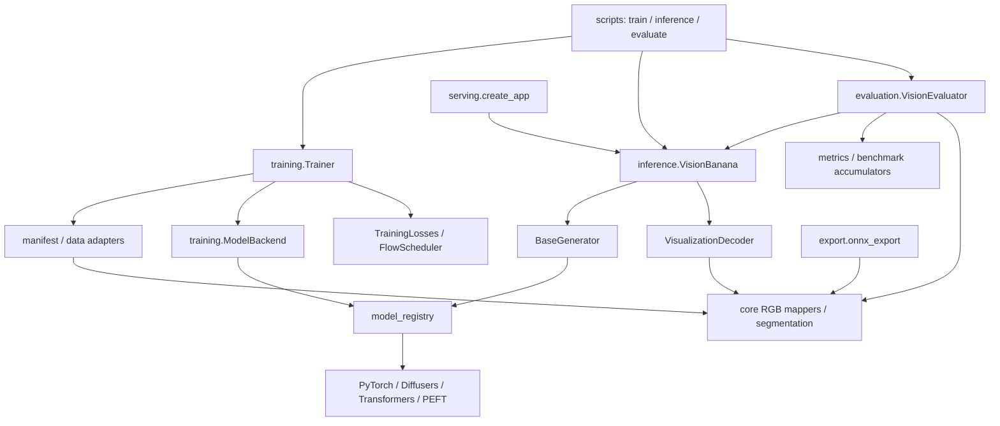

# 整体架构与仓库地图

[返回首页](README.md)

## 1. 定位与设计思想

Open Vision Banana 是 Vision Banana 范式的非官方开源实现，不是论文闭源模型的权重复刻。主要方式是“视觉目标 → RGB 表达 → 图像条件生成 → 结构化解码”，让不同任务复用同一个生成骨干和适配器。

系统分成两种空间：训练时优化图像或 latent 上的生成目标；评估时把 RGB 解析为米制深度、法向向量、类别标签或实例集合。RGB 视觉上合理不等于结构化指标正确，编码与解码契约是贯穿架构的基础。

公共推理支持十个任务名：`semantic`、`instance`、`referring`、`depth`、`normal`、`edge`、`flow`、`keypoint`、`object_detection`、`depth_edge`。训练 manifest 还可能使用 `structure` 或别名 `seg` / `metric_depth`，不能直接假设所有训练名称都被公共推理 API 接受。

## 2. 仓库地图

```text
open-vision-banana/
  pyproject.toml              构建、依赖 extras、pytest/Ruff/mypy 配置
  requirements.txt            另一组开发安装依赖，不是完整 extras 清单
  src/open_vision_banana/
    __init__.py              版本、顶层惰性公共接口
    config.py                旧版嵌套配置 VisionBananaConfig
    model_registry.py        多模型架构配置、加载、编码和前向适配
    conditioning.py          SSD/SDXL 源图 latent 拼接契约
    spatial_adapter.py       可选源图空间适配器
    task_prompts.py           固定任务提示，含 Cityscapes 19 类图例
    dynamic_prompts.py        按任务元信息生成历史数据提示
    reproducibility.py       数据/运行环境/工作树指纹
    depth_probe_checkpoint.py 冻结探针 artifact 格式
    core/                    任务 RGB 编解码和实例聚类算法
    data/                    数据适配、manifest、混合采样与归档访问
    training/                统一训练及旧版训练设施
    inference/               模型、LoRA、采样、解码、高层 API
    evaluation/              指标、协议、累加器和评估流水线
    export/                  mapper 与 FLUX transformer ONNX 导出
    serving/                 FastAPI 适配层
    tiny_model*.py           独立轻量模型及迭代版本
  scripts/                   活跃训练、推理、评估、下载、准备和启动命令
    archive/                 历史脚本，非默认生产入口
  configs/                   模型训练、硬件、编码、checkpoint 配置
    experiments/             单次实验与 specialist 配置
  tests/                     单元、集成、契约、mock、GPU 和回归测试
  experiments/               算法消融、量化、性能及多任务一致性实验
  notebooks/colab_demo.ipynb  交互式示例
  templates/                 发布用模型卡模板
  docs/                      工程概览、研究报告、计划和 ADR
  docker/                    CPU/GPU Dockerfile 与 Compose
  .github/workflows/         CI、发布与性能回归
  output/                    本地实验产物，不是包源码或权重交付保证
```

[`agent.md`](../../agent.md) 和 `.claude/` 是仓库协作/工作流资料，不是 Python 执行入口。不存在统一的 Web 前端应用；HTTP 能力由 FastAPI 工厂提供。

## 3. 分层依赖



逻辑依赖方向不等于严格 import 隔离：例如 `FrozenDepthEstimator` 引用了 `training.depth_probe` 中的特征和探针类，`training/__init__.py` 也重导出旧设施。不要仅根据目录名字估算导入成本。顶层包通过 `__getattr__` 延迟加载重型接口，目的是减少只使用基础算法时的模型依赖。

## 4. 当前主要执行链

### 4.1 统一训练

```text
scripts/train.py.main
  build_arg_parser → load_config → TrainingConfig.validate
  Trainer.__init__
    init_distributed → _build_datasets → ManifestVisionDataset
    ModelBackend → resolve_model_config → load_pipeline → apply_lora
    TrainingLosses + TrainingCallbacks + EMAModel + AdamW + SchedulerFactory
  Trainer.train
    _train_step → VAE encode → prepare_flow_batch → encode_text
    backend.forward → loss.backward → LoRA 梯度 all-reduce → optimizer.step
    validate → best checkpoint / regular checkpoint / final checkpoint
```

关键入口：[train.py](../../scripts/train.py)、[Trainer](../../src/open_vision_banana/training/trainer.py#L205)、[ModelBackend](../../src/open_vision_banana/training/model_backend.py#L102)。

### 4.2 视觉推理

```text
图像 [-1,1] + task + 任务参数
  VisionBanana.predict
  prompt 解析，优先明确传入或 checkpoint 中的训练指令
  BaseGenerator.generate
    SANA: 自定义 source→target Flow Matching
    FLUX: 自定义 img2img Flow Matching
    instruction editor: 官方编辑管线
    source-conditioned SSD: 条件契约采样
    其他: 构建 img2img 管线
  RGB [0,1]
  VisualizationDecoder → core
  结构化结果 + rgb_output + prompt + metadata
```

关键入口：[VisionBanana](../../src/open_vision_banana/inference/pipeline.py#L43)、[BaseGenerator](../../src/open_vision_banana/inference/generator.py#L150)。

### 4.3 独立评估

`evaluate_paper_benchmarks.py` 先定位数据集与协议，构建 loader 和模型，通过 `VisionEvaluator.evaluate()` 评估，再写 JSON/CSV。数据读取可附带原始 GT 和有效掩码；论文评估不应仅从有损 RGB 标签恢复 GT。

`EvalPipeline` 是另一条契约驱动的三任务 RGB 评估便利接口，不等于论文 benchmark runner。

## 5. 三类研究路线

### 5.1 生成式任务模型

当前统一训练入口主导 SANA / FLUX 多任务与 specialist 实验。编辑模型把源图作为独立条件；普通生成骨干通过 source latent 到 target latent 的 flow 桥接。SSD/SDXL 的显式 8 通道源图条件路线在旧版 `InstructionTuner` 和 `conditioning.py` 中。

### 5.2 冻结特征深度探针

`FrozenSDXLDepthFeatureExtractor` 从冻结的 VAE/UNet 取特征；`ScalarDepthProbe` 学习连续标量图；`FrozenDepthEstimator` 加载 artifact 后直接预测。没有反复去噪生成过程，输出为归一化相对深度，不应作为米制深度论文复现。

### 5.3 Tiny CNN 对照

`tiny_model.py` 是紧凑 U-Net 风格共享模型，以任务 embedding 调制预测。V2 引入 FiLM 和任务头，V4 文件主要提供改进损失，V5 进一步调整 FiLM、输出激活和任务头。它们不依赖扩散骨干，checkpoint 和接口不能跨版本混用。

历史路线文档中的“当前最佳”仅针对其写作日期，本 Wiki 不重新宣称历史性能；参见[路线边界](../ROUTE_BOUNDARIES.md)。

## 6. 横切设计

- 模型架构适配集中到 `model_registry.py` 与 `ModelBackend`，任务结构化解析集中到 `core/`。
- 任务提示来自多处，明确 prompt、checkpoint 元信息、固定 Cityscapes 提示和全局编码 YAML 不是一个统一自动合并系统。
- checkpoint 同时承担可恢复训练状态和推理适配器交付，两者权重来源可能不同。
- 数据集和实验 manifest 指纹帮助追踪结果，但并非所有脚本都自动使用同一套指纹设施。
- 现有测试包含 mock 和 tiny-width 模型路径；通过它们不能推导所有注册 Hub 大模型的训练都已验证。
